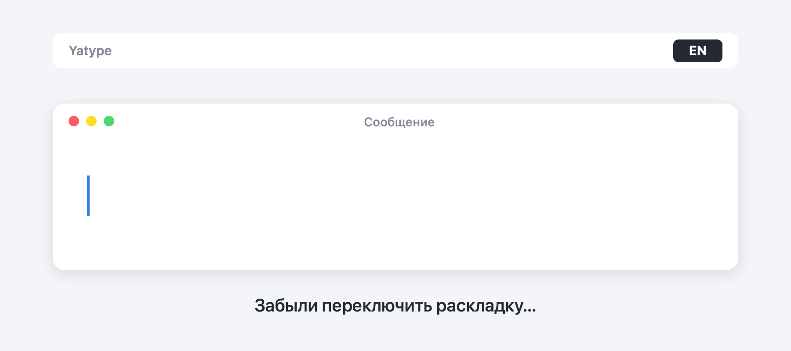

<p align="center">
  
</p>

<h1 align="center">Yatype</h1>

<p align="center">
  <b>Автопереключатель раскладки для macOS и Windows.</b><br>
  Забыли переключить язык? Yatype сам исправит набранное и переключит раскладку.
</p>

<p align="center">
  <a href="https://github.com/Yatype/yatype/releases/latest"><b>⬇ Скачать для macOS и Windows</b></a>
  &nbsp;·&nbsp; бесплатно &nbsp;·&nbsp; без рекламы и слежки
</p>

<p align="center">
  
</p>

Набрали «**ghbdtn rfr ltkf**», потому что забыли переключить раскладку? Yatype
сам превратит это в «**привет как дела**» и переключит раскладку на русскую —
дальше вы печатаете уже по-русски. И наоборот: «руддщ» → «hello».

Программа для тех, кто каждый день пишет на двух языках: по-русски и
по-английски. Работает как Punto Switcher, но на современных Mac и Windows —
бесплатная замена Punto Switcher для Mac, Caramba Switcher и переключения
раскладки вручную.

## Что умеет

- **Исправляет на лету.** Как только вы нажали пробел или Enter. В мессенджере
  уходит уже исправленное сообщение.
- **Понимает фразу целиком.** Короткие «я», «и», «в» исправляются вместе с
  соседними словами.
- **Знает живой язык**: разговорные слова, сленг, мат, аббревиатуры (вк, тг,
  др, lol, idk), слова с опечатками. Больше миллиона словоформ.
- **Отмена одной клавишей.** Двойной Control сразу после исправления
  возвращает как было и запоминает слово. Если исправлять было нечего — та же
  клавиша переводит последнее слово вручную.
- **Клавишу можно выбрать**: двойной Shift, Option/Alt, Command/Win, своё
  сочетание или Backspace сразу после исправления.
- **Не лезет куда не надо**: поля паролей, терминалы, менеджеры паролей.
  Любую программу можно исключить из меню.

## Приватность

- **Ничего не отправляет в интернет.** В программе нет ни одного сетевого
  запроса — код открыт для проверки.
- **Набранный текст не сохраняется.** В памяти только последние несколько
  слов, и они забываются при каждом клике.
- **В полях паролей не видит ввод.**
- На диске — только ваши настройки, на вашем компьютере.

## Установка на Mac

**Одной командой**, если у вас есть [Homebrew](https://brew.sh) — без
предупреждения macOS о разработчике:

```bash
brew install --cask yatype/tap/yatype
```

**Или вручную:**

1. Скачайте `Yatype-<версия>.dmg` со страницы
   [релизов](https://github.com/Yatype/yatype/releases/latest).
2. Откройте его и перетащите **Yatype** в «Программы».
3. Запустите. Программа бесплатная и не подписана платным сертификатом Apple,
   поэтому macOS скажет, что не может проверить разработчика. Откройте
   **Системные настройки → Конфиденциальность и безопасность**, пролистайте
   вниз и нажмите **«Всё равно открыть»** напротив Yatype. Это нужно один раз.
4. Выдайте доступ **«Универсальный доступ»** — программа сама покажет, где.
   Без него она не может исправлять текст.

Значок **EN/RU** появится в строке меню.

Нужна macOS 10.15 или новее, Apple Silicon или Intel.

## Установка на Windows

1. Скачайте `Yatype-Setup-<версия>-beta.exe` со страницы
   [релизов](https://github.com/Yatype/yatype/releases/latest).
2. Запустите. Windows может показать «Система Windows защитила ваш компьютер»
   — так она реагирует на любую программу без платной подписи. Нажмите
   **«Подробнее» → «Выполнить в любом случае»**.
3. Права администратора не нужны. Значок **EN/RU** появится в трее рядом с
   часами, клик по нему — меню.

Есть и версия без установки: `Yatype-<версия>-beta-windows-portable.zip`.

Нужны Windows 10 или 11, 64-бит.

Пометка «бета» значит, что Windows-версия новая: она проходит все те же
автоматические тесты, что и версия для Mac, но живых пользователей у неё
пока мало. Если заметите что-то странное — напишите, исправим быстро.
Чем она пока отличается от Mac-версии: настройки — в меню значка, а не в
отдельном окне, и в программах, запущенных от имени администратора, Yatype
не работает (так устроена защита Windows).

## Нужны две раскладки

Русская и английская раскладки должны быть включены в системе.

## Нашли ошибку?

Напишите в [Issues](https://github.com/Yatype/yatype/issues): в какой
программе, что набирали и что получилось. Набранный текст из примера можно
заменить похожим.

---

## English

**Yatype** fixes text typed in the wrong keyboard layout (Russian ↔ English)
and switches the layout for you — like Punto Switcher, for modern macOS and
Windows. Free, no ads, no tracking, works offline. Type “ghbdtn” and get
“привет”; double-tap Control to undo. [Download](https://github.com/Yatype/yatype/releases/latest).

---

## Для разработчиков

```bash
cargo test --release            # все тесты
cargo build --release           # программа для текущей системы
tools/build_dmg.sh              # установщик для macOS
```

- `crates/detector` — определитель неправильной раскладки (словари и модель
  буквосочетаний).
- `crates/engine` — логика: исправление, отмена, горячие клавиши. Не зависит
  от системы и тестируется на «фейковой» системе.
- `crates/switcher` — программа: слои для macOS и Windows.

Сборка и релизы — в GitHub Actions ([.github/workflows/build.yml](.github/workflows/build.yml)).

## Можно ли пользоваться

**Да, свободно.** Программа бесплатная: скачивайте, ставьте на любые свои
компьютеры, делитесь ссылкой с друзьями.

Исходный код выложен открыто, чтобы любой мог проверить: программа делает
только то, что написано выше, и ничего никуда не отправляет. Брать этот код
в свои проекты без разрешения автора нельзя — подробности в [LICENSE](LICENSE).

© 2026 Yatype.

Словари: русский — на основе Hunspell (А. Лебедев), английский — ENABLE
(общественное достояние), частые и современные слова — собственные списки
проекта. Уведомления о лицензиях словарей и библиотек — в
[data/LICENSES.txt](data/LICENSES.txt).
